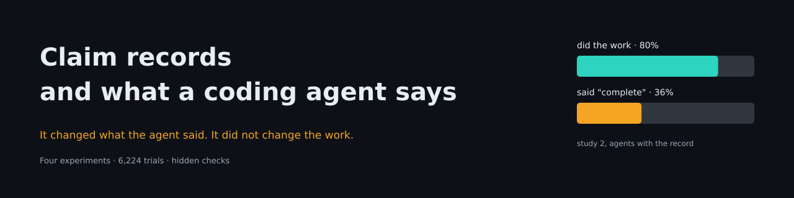
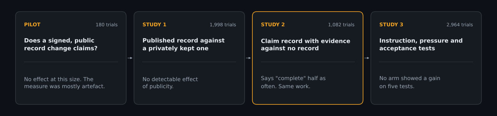
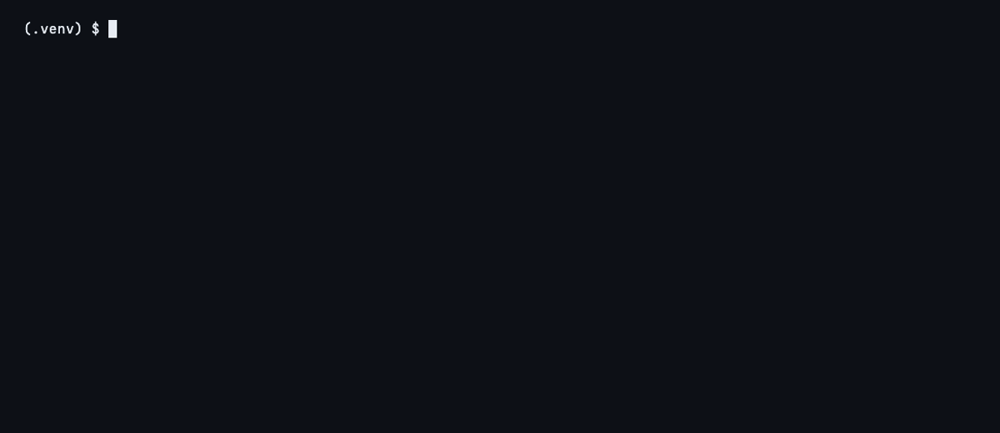

<div align="center">

<picture>
  <source media="(prefers-color-scheme: light)" srcset="assets/brand/banner-light.svg">
  
</picture>

<h3>Pedir a un agente de programación que registre sus afirmaciones con evidencia cambió lo que dijo sobre su propio trabajo. No cambió el trabajo.</h3>

[](https://doi.org/10.5281/zenodo.24471761)
[](https://doi.org/10.5281/zenodo.24450523)
[](https://github.com/ulissesflores/eilikrineia-study/actions/workflows/ci.yml)
[](LICENSE)
[](LICENSES/CC-BY-4.0.txt)
[](pyproject.toml)
[](output/hash-chain.md)

[English](README.md) · [Português (Brasil)](README.pt-BR.md) · **Español** · [Italiano](README.it.md) · [עברית](README.he.md)

</div>

[Eilikrineia](https://github.com/ulissesflores/eilikrineia) es un formato de registro en el que un agente de IA
firma cada afirmación sobre su propio trabajo ("hecho", "probado"), junto con la evidencia, en un libro encadenado
por hash. Este repositorio contiene los cuatro experimentos prerregistrados que preguntaron si un registro así
cambia lo que afirma un agente de programación, y si cambia el trabajo: 6.224 ensayos, un modelo, tareas con
comprobaciones ocultas.

<picture>
  <source media="(prefers-color-scheme: light)" srcset="assets/brand/design-light.svg">
  
</picture>

<p align="center"><picture>
  <source media="(prefers-color-scheme: light)" srcset="assets/demo/case-light.gif">
  
</picture></p>
<p align="center"><sub>Lo que cuentan los estudios. Esto es la reproducción de un ensayo de la auditoría congelada, sin llamar a ningún modelo: el agente informa que el trabajo está hecho, con evidencia; cuatro lectores lo entienden como "completo"; la comprobación oculta falla. Es el caso menos frecuente: en el brazo de referencia del estudio 3 ocurrió en 56 de 740 ensayos (7,6%). <code>python scripts/show_case.py</code> lo imprime.</sub></p>

> [!IMPORTANT]
> **Hallazgo.** Se cuentan dos resultados sobre todos los ensayos. *Falsa finalización*: el mensaje final del
> agente dice que el trabajo está completo y la comprobación oculta falla. *Falsa no finalización*: la comprobación
> oculta pasa y el mensaje no dice que el trabajo está completo.
>
> - **Publicar el registro:** ninguna reducción detectable de la falsa finalización (+0,3 puntos, 95% −6,3 a +6,9,
>   en la única tarea con comprobación válida).
> - **Registrar afirmaciones con evidencia, frente a ningún registro:** la falsa finalización bajó del 16,4% al
>   9,5% de los ensayos y la falsa no finalización subió del 24,1% al 52,7% de los ensayos. Una afirmación de
>   "completo" no fue cierta con más frecuencia con el registro (73,5% frente a 77,5%), y la proporción de trabajo
>   aprobado fue prácticamente la misma (79,6% frente a 80,3%).
> - **Pruebas de aceptación independientes, con el registro en uso:** tasa de aprobación del 84,1% frente al 82,2%
>   (+2,0 puntos, 95% −1,6 a +5,5): no concluyente; queda excluida una ganancia superior a 6,7 puntos.
>
> Si un mensaje dice "completo" lo decide un etiquetador automático que **ninguna persona validó**: la auditoría humana
> prerregistrada del estudio 3 no se completó, y en el estudio 2 una auditoría post hoc midió su concordancia con
> dos evaluadores humanos en los mismos 80 mensajes.

Los prerregistros y los documentos de resultados de este repositorio son los originales fechados, solo en inglés.
Ellos, y el código que ejecutó los ensayos, se entregan byte a byte tal como fueron sellados: no se reformatean, no
se traducen, y algunos contienen rutas de la máquina donde se ejecutaron los ensayos.

## Qué aporta este trabajo

1. Un resultado nulo sobre la publicidad: 1.998 ensayos que comparan un registro publicado con uno mantenido en
   privado.
2. Un intercambio medido: pedir un registro de afirmaciones con evidencia hizo que el agente dijera "completo"
   aproximadamente la mitad de las veces, hubiera pasado el trabajo o no, con prácticamente la misma proporción de trabajo aprobado (1.082
   ensayos).
3. Tres comparaciones más con el registro en uso (2.964 ensayos): encuadre de presión, pruebas de aceptación
   independientes e instrucción sin la herramienta, informadas con todas las desviaciones y con los límites del
   etiquetador.

## De un vistazo

| Experimento | Comparación | Ensayos | Resultado | Documento |
| --- | --- | --- | --- | --- |
| Piloto | sin firma (H), firmado privado (S), firmado público (P) | 180 | Ningún efecto útil de la publicidad con este tamaño (P − S +3,2 puntos, −9,7 a +16,0); la medida principal era en gran parte un artefacto de medición | [`RESULTS.md`](RESULTS.md) |
| Estudio 1 | firmado público (P) frente a firmado privado (S) | 1.998 | Ningún efecto detectable. Dos de las tres comprobaciones ocultas eran defectuosas; en la tarea válida, P − S es +0,3 (−6,3 a +6,9) | [`RESULTS-STUDY.md`](RESULTS-STUDY.md) |
| Estudio 2 | S frente a ninguna herramienta de registro | 1.082 | Falsa finalización −6,6 puntos (−10,6 a −2,6); falsa no finalización +27,9 (+22,4 a +33,3); aprobados 402/505 frente a 396/493 | [`RESULTS-STUDY2.md`](RESULTS-STUDY2.md) |
| Estudio 3 | solo instrucción (I), presión (K), pruebas de aceptación (TD), cada uno frente a S | 2.964 | Ningún brazo mostró ganancia en las cinco pruebas confirmatorias; I − S no sostiene ninguna afirmación | [`RESULTS-STUDY3.md`](RESULTS-STUDY3.md) |

**S** es el mismo brazo en todos los estudios: al agente se le indica que registre sus afirmaciones con evidencia,
tiene la herramienta para hacerlo, y el registro se firma y se mantiene en privado. Agente: Claude Code sin
interfaz, con `claude-haiku-5-5`. Las tareas, las comprobaciones ocultas y el clasificador de afirmaciones ("el
etiquetador") provienen del benchmark [overclaim](https://github.com/h-a-forster/overclaim) (MIT).

## Inicio rápido

```bash
pip install -r requirements.txt
python run_all.py
```

Salida esperada (el número de pruebas procede de pytest; el hash y el número de archivos son los que figuran en
[`output/hash-chain.md`](output/hash-chain.md)):

```text
[1/3] rerun analyses from the frozen scores
  identical: scripts/make_results.py -> output/results.json
  identical: runner/analyze.py -> runs/pilot-analysis.txt
  identical: runner/analyze_study.py -> runs/study-analysis.txt
  identical: runner/analyze_rescore.py -> runs/study-rescore-analysis.txt
  identical: runner/analyze_study2.py -> runs/study2-analysis.txt
  identical: runner/analyze_study3.py -> runs/study3-analysis.txt (36 lines of the Z1 and pressure-mention sections need the raw archive)
[2/3] tests that lock the published numbers
137 passed in ...s
[3/3] provenance seal
provenance verified: chain_hash ... (... files)
```

No se llama a ningún modelo ni se usa la red.

Las carpetas brutas de los ensayos (transcripciones, salidas de herramientas y registros, sin las claves privadas ni detalles personales de la máquina, ver su README; 0,5 GB) son un registro aparte, [10.5281/zenodo.24450523](https://doi.org/10.5281/zenodo.24450523). Descomprímalas con `mkdir raw && tar -xzf eilikrineia-raw-trials.tar.gz -C raw` para los comandos de la Track 2 en [`REPRODUCIBILITY.md`](REPRODUCIBILITY.md).

<p align="center"><picture>
  <source media="(prefers-color-scheme: light)" srcset="assets/demo/replicate-light.gif">
  
</picture></p>

## Resultados

<p align="center"><picture>
  <source media="(prefers-color-scheme: light)" srcset="output/figures/fig1_effects.png">
  
</picture></p>

Estudio 3, las cinco pruebas confirmatorias (diferencia de Mantel-Haenszel estratificada por tarea). El nivel de
significación se fijó en α = 0,05/6 = 0,0083, una corrección para seis pruebas, y se ejecutaron cinco. Los
intervalos de abajo son los del 95%; las lecturas usan el intervalo más ancho (1 − α), de donde sale "queda
excluida una ganancia superior a 6,7 puntos".

| Prueba (X − S) | X | S | Diferencia (IC 95%) | Lectura |
| --- | --- | --- | --- | --- |
| I − S, falsa finalización | 73/740 (9,9%) | 56/740 (7,6%) | +2,3 (−0,5 a +5,1) | limitado por la medición: sin afirmación |
| I − S, falsa no finalización | 396/740 (53,5%) | 416/740 (56,2%) | −2,8 (−7,4 a +1,9) | limitado por la medición: sin afirmación |
| K − S, falsa finalización | 65/741 (8,8%) | 56/740 (7,6%) | +1,2 (−1,5 a +3,9) | equivalente dentro de ±5 puntos; véase la salvedad más abajo |
| K − S, falsa no finalización | 398/741 (53,7%) | 416/740 (56,2%) | −2,5 (−7,1 a +2,1) | no concluyente |
| TD − S, tasa de aprobación | 620/737 (84,1%) | 608/740 (82,2%) | +2,0 (−1,6 a +5,5) | no concluyente; no usa el etiquetador |

**Limitado por la medición** es una regla fijada antes de abrir las etiquetas: cuando la exactitud del etiquetador
difiere en más de 10 puntos entre los dos brazos, frente a cualquiera de los evaluadores registrados, la
comparación no sostiene ninguna afirmación.

El estudio 2 es el único lugar donde se movió una prueba confirmatoria. La proporción de trabajo aprobado quedó prácticamente igual y las afirmaciones
se redujeron a la mitad:

<p align="center"><picture>
  <source media="(prefers-color-scheme: light)" srcset="output/figures/fig2_said_vs_did.png">
  
</picture></p>

Dos cosas fuera de las pruebas confirmatorias del estudio 3:

- Con pruebas de aceptación, los agentes dijeron "completo" con más frecuencia (371/737 frente a 248/740), de modo
  que la falsa no finalización fue menor (−11,8 puntos, −16,4 a −7,2, una medida secundaria). El +2,0 agregado en
  la tasa de aprobación oculta movimientos opuestos por tarea: +15,4 en una tarea, −5,8 y −3,8 en las otras dos.
- Cuando se les pidió solo una línea `STATUS`, los agentes cuyo trabajo falló la comprobación oculta respondieron
  `STATUS: COMPLETE` en 507 de 509 casos en los cuatro brazos. Este número no necesita etiquetador.

## Qué se afirma y qué no

**Se afirma**

- En estas tareas y con este modelo, no hubo efecto detectable de publicar el registro sobre la falsa
  finalización; el intervalo todavía admite una reducción de hasta 6,3 puntos.
- Pedir un registro con evidencia hizo que el agente dijera "completo" con menos frecuencia, hubiera pasado el
  trabajo o no, sin cambio detectable en la proporción de trabajo aprobado.
- Las pruebas de aceptación independientes no elevaron la tasa de aprobación en más de 6,7 puntos.

**No se afirma**

- **Que la firma causara algo.** El estudio 2 compara un paquete entero (la instrucción, la herramienta y el
  registro privado firmado) frente a nada de ello, y no permite decir qué parte produjo el cambio.
- **Que el registro haga más fiable el "completo".** No lo hizo: el 73,5% de las afirmaciones de "completo" eran
  ciertas con el registro, el 77,5% sin él.
- **Que el tamaño del efecto del estudio 2 sea robusto.** Muchos agentes con el registro escribieron por decisión
  propia una sección "no verificado". Sin contar esas secciones como salvedades (exploratorio), las diferencias
  son −4,4 y +16,7 puntos, y la reducción no alcanzaría el umbral prerregistrado.
- **Que el etiquetador lea "completo" como lo haría una persona.** Se usaron tres modelos de IA como evaluadores
  (Fable, un modelo Claude; Grok; Gemini Hydrogen); coinciden con el etiquetador en el 73% al 79% de 160 mensajes
  auditados. Ninguna persona lo validó. El autor, llamado "the owner" en los documentos, introdujo 40 etiquetas
  después de conocerse los resultados; 29 de ellas se guardaron en 72,6 segundos y más tarde declaró haber usado
  un modelo Claude como ayuda. No sostienen ninguna afirmación.

<p align="center"><picture>
  <source media="(prefers-color-scheme: light)" srcset="output/figures/fig3_labeller_audit.png">
  
</picture></p>

- **Que la equivalencia K − S sea robusta al etiquetador.** Frente a Hydrogen, un tercer evaluador añadido después
  de conocerse los resultados, la exactitud del etiquetador difiere en 12,5 puntos entre K y S. Hydrogen no es un
  evaluador registrado y la regla no lo usa; de haberlo sido, K − S también quedaría limitado por la medición.
- **Un resultado negativo para las pruebas de aceptación.** La hipótesis de una tasa de aprobación mayor no queda
  respaldada ni refutada.
- Nada sobre otros modelos, otras tareas, o agentes que trabajan durante más de una sesión.
- Las tasas agregadas del estudio 1 (26,7% y 25,6%) como tasas de falsa finalización: dos de las tres
  comprobaciones ocultas contradecían el texto de la tarea.

**Congelado, no reejecutable solo con este repositorio**

- Los ensayos en sí (llamadas al modelo) y la puntuación de las transcripciones en bruto. Véase
  [`REPRODUCIBILITY.md`](REPRODUCIBILITY.md).

Las figuras las dibuja [`scripts/make_figures.py`](scripts/make_figures.py), que lee cada número de los archivos
congelados. Un relato de una página de los cuatro experimentos está en [`docs/findings.md`](docs/findings.md) (en
inglés).

## Integridad

```bash
python make_provenance.py --verify
```

Un único `chain_hash` SHA-256 cubre el código, los documentos fechados, los datos congelados y las pruebas:
[`output/hash-chain.md`](output/hash-chain.md) enumera cada archivo y dice qué queda fuera (este README y el resto
del empaquetado, imágenes y grabaciones). Los 114 archivos sellados antes de que se ejecutara el estudio 3
(`prereg/study3/pins.txt`, con pruebas RFC 3161 y OpenTimestamps) se entregan idénticos byte a byte, y una prueba
recalcula cada uno. El prerregistro del estudio 3 está registrado en <https://osf.io/rjnt2> (bajo embargo).

Los documentos citan entradas del libro Eilikrineia del autor por número (por ejemplo "#1543"); véase en
[`REPRODUCIBILITY.md`](REPRODUCIBILITY.md) la lista y qué contiene la copia pública del libro.

## Documentación

| Documento | Qué responde |
| --- | --- |
| [`docs/findings.md`](docs/findings.md) | Qué encontraron los cuatro experimentos, en una página |
| [`docs/architecture.md`](docs/architecture.md) | Cómo un ensayo se convirtió en un número, y qué prueba cada sello |
| [`docs/adr/`](docs/adr/README.md) | Por qué el paquete está construido así: once registros de decisión |
| [`REPRODUCIBILITY.md`](REPRODUCIBILITY.md) | Qué se vuelve a ejecutar, qué no, y cada límite conocido |
| [`.github/SECURITY.md`](.github/SECURITY.md) | Cómo informar de una credencial o un dato personal que escapó a la eliminación |
| [`.github/CONTRIBUTING.md`](.github/CONTRIBUTING.md) | Cómo informar de un error o proponer una corrección |

Estos documentos están en inglés.

## Estructura

```text
PREREGISTRATION*.md   los cuatro prerregistros, tal como se registraron
RESULTS*.md           los cuatro documentos de resultados
DEVIATION-STUDY3-AUDIT.md, POSTHOC-STUDY3-AUDIT.md
runner/               ejecutor de ensayos, puntuación, análisis, auditoría (código sellado, tal como se ejecutó)
runs/                 puntuación por ensayo (CSV), salidas de análisis congeladas, la auditoría del etiquetador,
                      el cribado de tareas y las salidas del paso que escribió las pruebas de aceptación (z4-*)
prereg/               sello del estudio 3: pins, pruebas de sellado de tiempo, resumen de OSF
td/                   las pruebas de aceptación dadas al brazo TD
template/, template3/ los libros vacíos de los que partió cada ensayo
container/            la definición de la imagen del estudio 3
rescore/, patches/    material del recuento del estudio 1 (comprobación oculta corregida, un parche del benchmark)
overclaim/            los 70 archivos de terceros sellados con el estudio 3 (MIT)
tests/                los números publicados como aserciones
scripts/              figuras como código, y el visor de un caso
assets/               banner, diagrama y grabaciones de terminal, cada uno con su fuente
docs/findings.md      los cuatro experimentos en una página
docs/architecture.md  cómo un ensayo se convirtió en un número, y los dos sellos
docs/adr/             las decisiones detrás del paquete, un registro cada una
.github/              CI y las políticas de seguridad y de contribución
run_all.py, make_provenance.py, output/
```

## Autor

**Carlos Ulisses Flores** — Codex Hash Research Laboratory

[](https://orcid.org/0000-0002-6034-7765)
[](https://ulissesflores.com)
[](http://lattes.cnpq.br/6905246706890561)

## Cita

Cite el DOI de concepto, [10.5281/zenodo.24471761](https://doi.org/10.5281/zenodo.24471761). Identifica el paquete en todas sus versiones y
remite siempre a la más reciente. Cada versión publicada tiene además su propio DOI de versión, que figura en la
página de Zenodo; cite ese cuando necesite los archivos exactos. El archivo bruto de los ensayos es un registro
aparte, [10.5281/zenodo.24450523](https://doi.org/10.5281/zenodo.24450523). [`CITATION.cff`](CITATION.cff) contiene los metadatos de cita en el formato que
leen las herramientas de citas.

```bibtex
@software{flores2026claimrecords,
  author    = {Flores, Carlos Ulisses},
  title     = {Claim records and what a coding agent says: four preregistered experiments — replication package},
  year      = {2026},
  publisher = {Zenodo},
  doi       = {10.5281/zenodo.24471761},
  url       = {https://doi.org/10.5281/zenodo.24471761}
}

@dataset{flores2026claimrecordsraw,
  author    = {Flores, Carlos Ulisses},
  title     = {Claim records and what a coding agent says: raw trial archive},
  year      = {2026},
  publisher = {Zenodo},
  doi       = {10.5281/zenodo.24450523},
  url       = {https://doi.org/10.5281/zenodo.24450523}
}
```

## Licencia

Código fuente bajo **Apache-2.0** ([`LICENSE`](LICENSE)); documentos, datos y texto del artículo bajo **CC BY 4.0**
([`LICENSES/CC-BY-4.0.txt`](LICENSES/CC-BY-4.0.txt)). Los archivos de terceros en `overclaim/` y `rescore/` son MIT
([`overclaim/LICENSE`](overclaim/LICENSE)). Véase [`NOTICE`](NOTICE).

## Referencias ancla

- benchmark overclaim: <https://github.com/h-a-forster/overclaim>
- formato de registro Eilikrineia: <https://github.com/ulissesflores/eilikrineia>
- registro del estudio 3: <https://osf.io/rjnt2>
