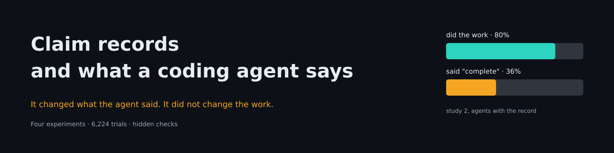
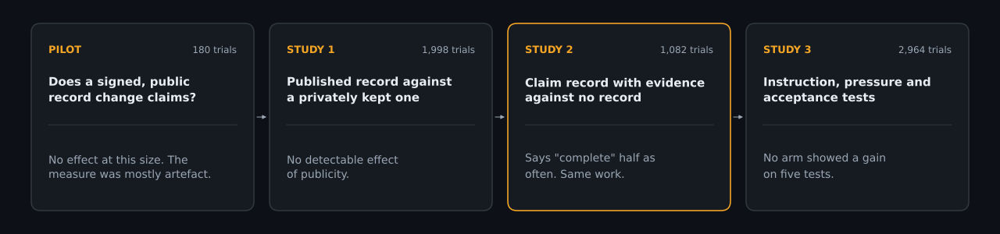
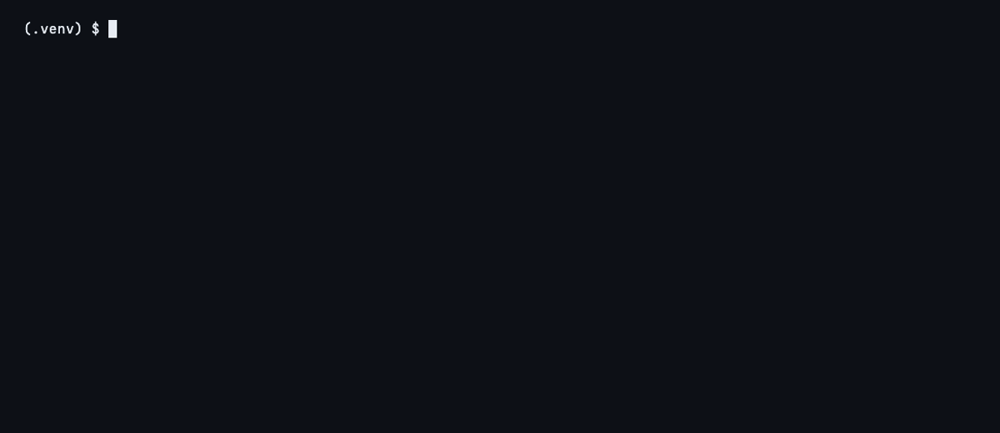

<div align="center">

<picture>
  <source media="(prefers-color-scheme: light)" srcset="assets/brand/banner-light.svg">
  
</picture>

<h3 dir="rtl">הבקשה מסוכן תכנות לרשום את טענותיו יחד עם ראיות שינתה את מה שאמר על עבודתו. היא לא שינתה את העבודה.</h3>

[](LICENSE)
[](LICENSES/CC-BY-4.0.txt)
[](pyproject.toml)
[](tests/test_published_numbers.py)
[](output/hash-chain.md)

[English](README.md) · [Português (Brasil)](README.pt-BR.md) · [Español](README.es.md) · [Italiano](README.it.md) · **עברית**

</div>

<div dir="rtl">

[Eilikrineia](https://github.com/ulissesflores/eilikrineia) הוא פורמט רישום שבו סוכן בינה מלאכותית חותם על כל
טענה על עבודתו ("בוצע", "נבדק"), יחד עם הראיות, ביומן המשורשר באמצעות hash. מאגר זה מכיל את ארבעת הניסויים
שנרשמו מראש ושאלו אם רישום כזה משנה את מה שסוכן תכנות טוען, ואם הוא משנה את העבודה: 6,224 הרצות, מודל אחד,
משימות עם בדיקות נסתרות.

</div>

<picture>
  <source media="(prefers-color-scheme: light)" srcset="assets/brand/design-light.svg">
  
</picture>

<p align="center"><picture>
  <source media="(prefers-color-scheme: light)" srcset="assets/demo/case-light.gif">
  
</picture></p>
<p align="center" dir="rtl"><sub>מה המחקרים סופרים. זהו שחזור של הרצה אחת מתוך הביקורת הקפואה, ללא קריאה למודל: הסוכן מדווח שהעבודה בוצעה, עם ראיות; ארבעה קוראים מבינים "הושלם"; הבדיקה הנסתרת נכשלת. זהו המקרה הפחות שכיח: בזרוע הייחוס של מחקר 3 זה קרה ב-56 מתוך 740 הרצות (7.6%). הפקודה <code>python scripts/show_case.py</code> מדפיסה אותו.</sub></p>

<div dir="rtl">

> [!IMPORTANT]
> **הממצא.** שתי תוצאות נספרות מתוך כלל ההרצות. *השלמה כוזבת*: ההודעה הסופית של הסוכן אומרת שהעבודה הושלמה
> והבדיקה הנסתרת נכשלת. *אי-השלמה כוזבת*: הבדיקה הנסתרת עוברת וההודעה אינה אומרת שהעבודה הושלמה.
>
> - **פרסום הרישום:** אין ירידה ניתנת לזיהוי בהשלמה הכוזבת (+0.3 נקודות, 95% בין −6.3 ל-+6.9, במשימה היחידה
>   שבה הבדיקה תקפה).
> - **רישום טענות עם ראיות, לעומת היעדר רישום:** ההשלמה הכוזבת ירדה מ-16.4% ל-9.5% מההרצות, ואי-ההשלמה הכוזבת
>   עלתה מ-24.1% ל-52.7% מההרצות. טענת "הושלם" לא הייתה נכונה לעיתים קרובות יותר עם הרישום (73.5% לעומת
>   77.5%), ושיעור העבודה שעברה נשאר כמעט זהה (79.6% לעומת 80.3%).
> - **בדיקות קבלה עצמאיות, כשהרישום בשימוש:** שיעור מעבר של 84.1% לעומת 82.2% (+2.0 נקודות, 95% בין −1.6
>   ל-+5.5): לא מכריע; שיפור של יותר מ-6.7 נקודות נשלל.
>
> השאלה אם הודעה אומרת "הושלם" מוכרעת בידי מתייג אוטומטי ש**אף אדם לא תיקף**.

מסמכי הרישום המוקדם ומסמכי התוצאות שבמאגר זה הם המקור המתוארך, באנגלית בלבד. הם, והקוד שהריץ את ההרצות,
מסופקים בית אחר בית כפי שנחתמו: הם אינם מעוצבים מחדש, אינם מתורגמים, וחלקם מכילים נתיבים של המחשב שבו בוצעו
ההרצות.

## מה העבודה הזו תורמת

1. תוצאת אפס לגבי פומביות: 1,998 הרצות שהשוו רישום שפורסם לרישום שנשמר באופן פרטי.
2. חילוף שנמדד: הבקשה לרישום טענות עם ראיות גרמה לסוכן לומר "הושלם" בערך בחצי מהפעמים, בין שהעבודה עברה ובין
   שלא, כששיעור העבודה שעברה נשאר כמעט זהה (1,082 הרצות).
3. שלוש השוואות נוספות כשהרישום בשימוש (2,964 הרצות): מסגור של לחץ, בדיקות קבלה עצמאיות והנחיה ללא הכלי,
   המדווחות עם כל סטייה ועם מגבלות המתייג.

## במבט אחד

| ניסוי | ההשוואה | הרצות | תוצאה | מסמך |
| --- | --- | --- | --- | --- |
| פיילוט | ללא חתימה (H), חתום פרטי (S), חתום פומבי (P) | 180 | אין אפקט שימושי של פומביות בגודל זה (P − S +3.2 נקודות, −9.7 עד +16.0); המדד העיקרי היה ברובו תוצר של המדידה | [`RESULTS.md`](RESULTS.md) |
| מחקר 1 | חתום פומבי (P) מול חתום פרטי (S) | 1,998 | אין אפקט ניתן לזיהוי. שתיים משלוש הבדיקות הנסתרות היו פגומות; במשימה התקפה P − S הוא +0.3 (−6.3 עד +6.9) | [`RESULTS-STUDY.md`](RESULTS-STUDY.md) |
| מחקר 2 | S מול היעדר כלי רישום | 1,082 | השלמה כוזבת −6.6 נקודות (−10.6 עד −2.6); אי-השלמה כוזבת +27.9 (+22.4 עד +33.3); עברו 402/505 מול 396/493 | [`RESULTS-STUDY2.md`](RESULTS-STUDY2.md) |
| מחקר 3 | הנחיה בלבד (I), לחץ (K), בדיקות קבלה (TD), כל אחד מול S | 2,964 | אף זרוע לא הראתה שיפור בחמשת המבחנים המאששים; I − S אינו נושא טענה | [`RESULTS-STUDY3.md`](RESULTS-STUDY3.md) |

**S** היא אותה זרוע לאורך כל המחקרים: הסוכן מתבקש לרשום את טענותיו עם ראיות, יש בידיו הכלי לכך, והרישום נחתם
ונשמר באופן פרטי. הסוכן: Claude Code במצב ללא ממשק, עם `claude-haiku-5-5`. המשימות, הבדיקות הנסתרות ומסווג
הטענות ("המתייג") מגיעים מהבנצ'מרק [overclaim](https://github.com/h-a-forster/overclaim) (MIT).

## התחלה מהירה

</div>

```bash
pip install -r requirements.txt
python run_all.py
```

<div dir="rtl">

הפלט הצפוי (מספר הבדיקות, ה-hash ומספר הקבצים הם אלה שב-[`output/hash-chain.md`](output/hash-chain.md)):

</div>

```text
[1/3] rerun analyses from the frozen scores
  identical: scripts/make_results.py -> output/results.json
  identical: runner/analyze.py -> runs/pilot-analysis.txt
  identical: runner/analyze_study.py -> runs/study-analysis.txt
  identical: runner/analyze_rescore.py -> runs/study-rescore-analysis.txt
  identical: runner/analyze_study2.py -> runs/study2-analysis.txt
  identical: runner/analyze_study3.py -> runs/study3-analysis.txt (36 lines of the Z1 and pressure-mention sections need the raw archive)
[2/3] tests that lock the published numbers
... passed in 0.2s
[3/3] provenance seal
provenance verified: chain_hash ... (... files)
```

<div dir="rtl">

לא נקרא אף מודל ולא נעשה שימוש ברשת.

</div>

<p align="center"><picture>
  <source media="(prefers-color-scheme: light)" srcset="assets/demo/replicate-light.gif">
  
</picture></p>

<div dir="rtl">

## תוצאות

</div>

<p align="center"><picture>
  <source media="(prefers-color-scheme: light)" srcset="output/figures/fig1_effects.png">
  
</picture></p>

<div dir="rtl">

מחקר 3, חמשת המבחנים המאששים (הפרש Mantel-Haenszel בריבוד לפי משימה). רמת המובהקות נקבעה ל-α = 0.05/6 = 0.0083,
תיקון לשישה מבחנים, וחמישה בוצעו. הרווחים שלהלן הם רווחי 95%; הקריאות משתמשות ברווח הרחב יותר (1 − α), וממנו
נובע "שיפור של יותר מ-6.7 נקודות נשלל".

| מבחן (X − S) | X | S | הפרש (רווח סמך 95%) | קריאה |
| --- | --- | --- | --- | --- |
| I − S, השלמה כוזבת | 73/740 (9.9%) | 56/740 (7.6%) | +2.3 (−0.5 עד +5.1) | מוגבל-מדידה: ללא טענה |
| I − S, אי-השלמה כוזבת | 396/740 (53.5%) | 416/740 (56.2%) | −2.8 (−7.4 עד +1.9) | מוגבל-מדידה: ללא טענה |
| K − S, השלמה כוזבת | 65/741 (8.8%) | 56/740 (7.6%) | +1.2 (−1.5 עד +3.9) | שקול בטווח של ±5 נקודות; ראו את ההסתייגות בהמשך |
| K − S, אי-השלמה כוזבת | 398/741 (53.7%) | 416/740 (56.2%) | −2.5 (−7.1 עד +2.1) | לא מכריע |
| TD − S, שיעור מעבר | 620/737 (84.1%) | 608/740 (82.2%) | +2.0 (−1.6 עד +5.5) | לא מכריע; אינו משתמש במתייג |

**מוגבל-מדידה** הוא כלל שנקבע לפני פתיחת התיוגים: כאשר דיוק המתייג שונה ביותר מ-10 נקודות בין שתי הזרועות, מול
כל אחד מהמעריכים הרשומים, ההשוואה אינה נושאת טענה.

מחקר 2 הוא המקום היחיד שבו מבחן מאשש זז. שיעור העבודה שעברה נשאר כמעט זהה והטענות ירדו בחצי:

</div>

<p align="center"><picture>
  <source media="(prefers-color-scheme: light)" srcset="output/figures/fig2_said_vs_did.png">
  
</picture></p>

<div dir="rtl">

שני דברים מחוץ למבחנים המאששים של מחקר 3:

- עם בדיקות קבלה, הסוכנים אמרו "הושלם" לעיתים קרובות יותר (371/737 מול 248/740), ולכן אי-ההשלמה הכוזבת הייתה
  נמוכה יותר (−11.8 נקודות, −16.4 עד −7.2, מדד משני). ה-+2.0 המצרפי בשיעור המעבר מסתיר תנועות הפוכות לפי
  משימה: +15.4 במשימה אחת, −5.8 ו-−3.8 בשתיים האחרות.
- כשהתבקשו לתת שורת `STATUS` בלבד, סוכנים שעבודתם נכשלה בבדיקה הנסתרת ענו `STATUS: COMPLETE` ב-507 מתוך 509
  מקרים בארבע הזרועות. מספר זה אינו תלוי במתייג.

## מה נטען ומה לא נטען

**נטען**

- במשימות אלה ובמודל זה, לא היה אפקט ניתן לזיהוי של פרסום הרישום על ההשלמה הכוזבת; הרווח עדיין מאפשר ירידה של
  עד 6.3 נקודות.
- הבקשה לרישום עם ראיות גרמה לסוכן לומר "הושלם" לעיתים רחוקות יותר, בין שהעבודה עברה ובין שלא, ללא שינוי ניתן לזיהוי
  בשיעור העבודה שעברה.
- בדיקות קבלה עצמאיות לא העלו את שיעור המעבר ביותר מ-6.7 נקודות.

**לא נטען**

- **שהחתימה גרמה למשהו.** מחקר 2 משווה חבילה שלמה (ההנחיה, הכלי והרישום הפרטי החתום) מול היעדר כל אלה, ואינו
  מאפשר לומר איזה חלק הביא לשינוי.
- **שהרישום הופך את ה"הושלם" לאמין יותר.** הוא לא: 73.5% מטענות ה"הושלם" היו נכונות עם הרישום, 77.5% בלעדיו.
- **שגודל האפקט במחקר 2 עמיד.** סוכנים רבים עם הרישום כתבו מיוזמתם סעיף "לא אומת". בלי לספור סעיפים אלה
  כהסתייגויות (ניתוח גישושי), ההפרשים הם −4.4 ו-+16.7 נקודות, והירידה לא הייתה עומדת בסף שנרשם מראש.
- **שהמתייג קורא "הושלם" כפי שאדם היה קורא.** שלושה מודלי בינה מלאכותית שימשו כמעריכים (Fable, מודל של Claude;
  Grok; Gemini Hydrogen); הם מסכימים עם המתייג ב-73% עד 79% מתוך 160 הודעות שנבדקו. אף אדם לא תיקף אותו.
  המחבר, המכונה "the owner" במסמכים, הזין 40 תיוגים לאחר שהתוצאות היו ידועות; 29 מהם נשמרו בתוך 72.6 שניות,
  והוא הצהיר לאחר מכן שנעזר במודל Claude. הם אינם תומכים באף טענה.

</div>

<p align="center"><picture>
  <source media="(prefers-color-scheme: light)" srcset="output/figures/fig3_labeller_audit.png">
  
</picture></p>

<div dir="rtl">

- **שהשקילות K − S עמידה ביחס למתייג.** מול Hydrogen, מעריך שלישי שנוסף לאחר שהתוצאות היו ידועות, דיוק המתייג
  שונה ב-12.5 נקודות בין K ל-S. Hydrogen אינו מעריך רשום והכלל אינו משתמש בו; אילו היה כזה, גם K − S היה
  מוגבל-מדידה.
- **תוצאה שלילית לבדיקות הקבלה.** ההשערה של שיעור מעבר גבוה יותר לא אוששה ולא הופרכה.
- דבר כלשהו על מודלים אחרים, משימות אחרות, או סוכנים שעובדים יותר מסשן אחד.
- השיעורים המצרפיים של מחקר 1 (26.7% ו-25.6%) כשיעורי השלמה כוזבת: שתיים משלוש הבדיקות הנסתרות סתרו את נוסח
  המשימה.

**קפוא, לא ניתן להרצה מחדש ממאגר זה לבדו**

- ההרצות עצמן (קריאות למודל) והניקוד של התמלילים הגולמיים. ראו [`REPRODUCIBILITY.md`](REPRODUCIBILITY.md).

התרשימים מצוירים בידי [`scripts/make_figures.py`](scripts/make_figures.py), הקורא כל מספר מהקבצים הקפואים. תיאור
בן עמוד אחד של ארבעת הניסויים נמצא ב-[`docs/findings.md`](docs/findings.md) (באנגלית).

## שלמות

</div>

```bash
python make_provenance.py --verify
```

<div dir="rtl">

`chain_hash` יחיד של SHA-256 מכסה את הקוד, המסמכים המתוארכים, הנתונים הקפואים והבדיקות:
[`output/hash-chain.md`](output/hash-chain.md) מפרט כל קובץ ואומר מה נשאר בחוץ (ה-README הזה ושאר האריזה, תמונות
והקלטות). 114 הקבצים שנחתמו לפני הרצת מחקר 3 (`prereg/study3/pins.txt`, עם הוכחות RFC 3161 ו-OpenTimestamps)
מסופקים זהים בית אחר בית, ובדיקה מחשבת מחדש כל אחד מהם. הרישום המוקדם של מחקר 3 רשום ב-<https://osf.io/rjnt2>
(תחת אמברגו).

המסמכים מצטטים רשומות מיומן ה-Eilikrineia של המחבר לפי מספר (לדוגמה "#1543"); ראו ב-
[`REPRODUCIBILITY.md`](REPRODUCIBILITY.md) את הרשימה ומה מכיל העותק הפומבי של היומן.

## מבנה

</div>

```text
PREREGISTRATION*.md   the four preregistrations, as registered
RESULTS*.md           the four results documents
DEVIATION-STUDY3-AUDIT.md, POSTHOC-STUDY3-AUDIT.md
runner/               trial runner, scoring, analysis, audit (sealed code, shipped as it ran)
runs/                 per-trial scores (CSV), frozen analysis outputs, the labeller audit,
                      the task screening and the outputs of the step that wrote the acceptance tests (z4-*)
prereg/               study 3 seal: pins, timestamp proofs, OSF summary
td/                   the acceptance tests given to arm TD
template/, template3/ the empty ledgers each trial started from
container/            the image definition of study 3
rescore/, patches/    material of the study 1 recount (corrected hidden check, one benchmark patch)
overclaim/            the 70 third-party files sealed with study 3 (MIT)
tests/                the published numbers as assertions
scripts/              figures as code, and the one-case viewer
assets/               banner, diagram and terminal recordings, each with its source
docs/findings.md      the four experiments in one page
run_all.py, make_provenance.py, output/
```

<div dir="rtl">

## המחבר

**Carlos Ulisses Flores** — Codex Hash Research Laboratory

[](https://orcid.org/0000-0002-6034-7765)
[](https://ulissesflores.com)
[](http://lattes.cnpq.br/6905246706890561)

## ציטוט

טרם הונפק DOI. כשיונפק, סעיף זה יציג את ה-DOI של המושג (כל הגרסאות) ואת ה-DOI של הגרסה. עד אז יש לצטט את
המאגר; ראו [`CITATION.cff`](CITATION.cff).

</div>

```bibtex
@misc{flores2026claimrecords,
  author       = {Flores, Carlos Ulisses},
  title        = {Claim records and what a coding agent says: four preregistered experiments},
  year         = {2026},
  version      = {0.1.0},
  howpublished = {Codex Hash Research Laboratory, replication package}
}
```

<div dir="rtl">

## רישיון

קוד המקור תחת **Apache-2.0** ([`LICENSE`](LICENSE)); מסמכים, נתונים וטקסט המאמר תחת **CC BY 4.0**
([`LICENSES/CC-BY-4.0.txt`](LICENSES/CC-BY-4.0.txt)). קובצי צד שלישי תחת `overclaim/` ו-`rescore/` הם ברישיון MIT
([`overclaim/LICENSE`](overclaim/LICENSE)). ראו [`NOTICE`](NOTICE).

## מקורות עוגן

- הבנצ'מרק overclaim: <https://github.com/h-a-forster/overclaim>
- פורמט הרישום Eilikrineia: <https://github.com/ulissesflores/eilikrineia>
- רישום מחקר 3: <https://osf.io/rjnt2>

</div>
