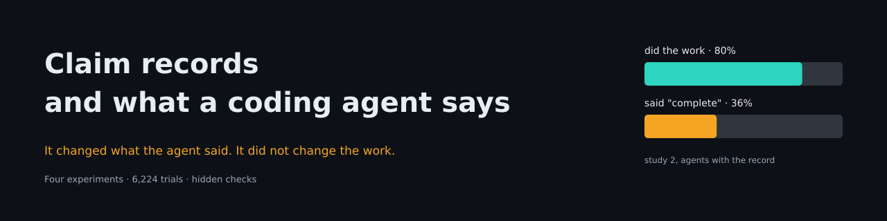
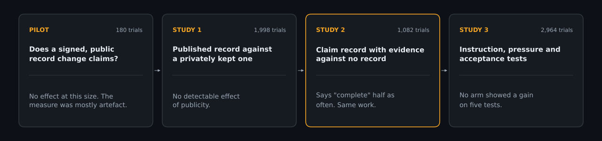
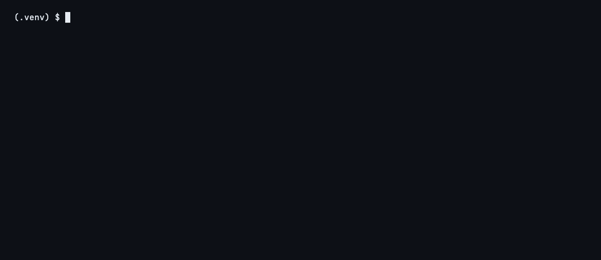
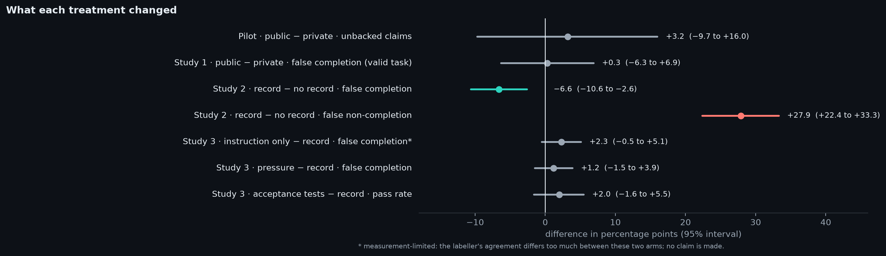

<div align="center">

<picture>
  <source media="(prefers-color-scheme: light)" srcset="assets/brand/banner-light.svg">
  
</picture>

<h3>Asking a coding agent to record its claims with evidence changed what it said about its work. It did not change the work.</h3>

[](LICENSE)
[](LICENSES/CC-BY-4.0.txt)
[](pyproject.toml)
[](tests/test_published_numbers.py)
[](output/hash-chain.md)

**English** · [Português (Brasil)](README.pt-BR.md) · [Español](README.es.md) · [Italiano](README.it.md) · [עברית](README.he.md)

</div>

[Eilikrineia](https://github.com/ulissesflores/eilikrineia) is a record format in which an AI agent signs each
claim about its own work ("done", "tested"), with the evidence, into a hash-chained log. This repository holds the
four preregistered experiments that asked whether such a record changes what a coding agent claims, and whether it
changes the work: 6,224 trials, one model, tasks with hidden checks.

<picture>
  <source media="(prefers-color-scheme: light)" srcset="assets/brand/design-light.svg">
  
</picture>

<p align="center"><picture>
  <source media="(prefers-color-scheme: light)" srcset="assets/demo/case-light.gif">
  
</picture></p>
<p align="center"><sub>What the studies count. This is a replay of one trial from the frozen audit, with no model call: the agent reports the work as done, with evidence; four readers take it as "complete"; the hidden check fails. It is the less common case: in the reference arm of study 3 it happened in 56 of 740 trials (7.6%). <code>python scripts/show_case.py</code> prints it.</sub></p>

> [!IMPORTANT]
> **Finding.** Two outcomes are counted over all trials. *False completion*: the agent's final message says the
> work is complete and the hidden check fails. *False non-completion*: the hidden check passes and the message does
> not say the work is complete.
>
> - **Publishing the record:** no detectable reduction in false completion (+0.3 points, 95% −6.3 to +6.9, on the
>   one task with a valid check).
> - **Recording claims with evidence, against no record at all:** false completion fell from 16.4% to 9.5% of
>   trials and false non-completion rose from 24.1% to 52.7% of trials. A "complete" claim was not more often true
>   with the record (73.5% against 77.5%), and the share of work that passed was about the same (79.6% against
>   80.3%).
> - **Independent acceptance tests, with the record in place:** pass rate 84.1% against 82.2% (+2.0 points, 95%
>   −1.6 to +5.5): inconclusive, a gain above 6.7 points is excluded.
>
> Whether a message says "complete" is decided by an automatic labeller that **no person validated**.

The preregistrations and results documents in this repository are the dated originals, in English only. They, and
the code that ran the trials, are shipped byte for byte as they were sealed: they are not reformatted, not
translated, and some contain paths of the machine where the trials ran.

## What this contributes

1. A null result on publicity: 1,998 trials comparing a published record with a privately kept one.
2. A measured trade: asking for a claim record with evidence made the agent say "complete" about half as often,
   whether or not the work passed, with about the same share of work passing (1,082 trials).
3. Three further comparisons with the record in place (2,964 trials): pressure framing, independent acceptance
   tests and instruction without the tool, reported with every deviation and with the limits of the labeller.

## At a glance

| Experiment | Compared | Trials | Result | Document |
| --- | --- | --- | --- | --- |
| Pilot | no signature (H), signed private (S), signed public (P) | 180 | No useful publicity effect at this size (P − S +3.2 points, −9.7 to +16.0); the primary measure was mostly a measurement artefact | [`RESULTS.md`](RESULTS.md) |
| Study 1 | signed public (P) against signed private (S) | 1,998 | No detectable effect. Two of three hidden checks were defective; on the valid task P − S is +0.3 (−6.3 to +6.9) | [`RESULTS-STUDY.md`](RESULTS-STUDY.md) |
| Study 2 | S against no record tool | 1,082 | False completion −6.6 points (−10.6 to −2.6); false non-completion +27.9 (+22.4 to +33.3); passed 402/505 against 396/493 | [`RESULTS-STUDY2.md`](RESULTS-STUDY2.md) |
| Study 3 | instruction only (I), pressure (K), acceptance tests (TD), each against S | 2,964 | No arm showed a gain on the five confirmatory tests; I − S carries no claim | [`RESULTS-STUDY3.md`](RESULTS-STUDY3.md) |

**S** is the same arm throughout: the agent is told to record its claims with evidence, has the tool to do it, and
the record is signed and kept privately. Agent: Claude Code headless with `claude-haiku-5-5`. Tasks, hidden checks
and the claim classifier ("the labeller") come from the [overclaim](https://github.com/h-a-forster/overclaim)
benchmark (MIT).

## Quick start

```bash
pip install -r requirements.txt
python run_all.py
```

Expected output (the test count, the hash and the file count are the ones in
[`output/hash-chain.md`](output/hash-chain.md)):

```text
[1/3] rerun analyses from the frozen scores
  identical: scripts/make_results.py -> output/results.json
  identical: runner/analyze.py -> runs/pilot-analysis.txt
  identical: runner/analyze_study.py -> runs/study-analysis.txt
  identical: runner/analyze_rescore.py -> runs/study-rescore-analysis.txt
  identical: runner/analyze_study2.py -> runs/study2-analysis.txt
  identical: runner/analyze_study3.py -> runs/study3-analysis.txt (36 lines of the Z1 and pressure-mention sections need the raw archive)
[2/3] tests that lock the published numbers
... passed in 0.2s
[3/3] provenance seal
provenance verified: chain_hash ... (... files)
```

No model is called and no network is used.

<p align="center"><picture>
  <source media="(prefers-color-scheme: light)" srcset="assets/demo/replicate-light.gif">
  
</picture></p>

## Results

<p align="center"><picture>
  <source media="(prefers-color-scheme: light)" srcset="output/figures/fig1_effects.png">
  
</picture></p>

Study 3, the five confirmatory tests (Mantel-Haenszel difference stratified by task). The significance level was
fixed at α = 0.05/6 = 0.0083, a correction for six tests, and five were run. The intervals below are the 95%
intervals; the readings use the wider (1 − α) interval, which is where "above 6.7 points is excluded" comes from.

| Test (X − S) | X | S | Difference (95% CI) | Reading |
| --- | --- | --- | --- | --- |
| I − S, false completion | 73/740 (9.9%) | 56/740 (7.6%) | +2.3 (−0.5 to +5.1) | measurement-limited: no claim |
| I − S, false non-completion | 396/740 (53.5%) | 416/740 (56.2%) | −2.8 (−7.4 to +1.9) | measurement-limited: no claim |
| K − S, false completion | 65/741 (8.8%) | 56/740 (7.6%) | +1.2 (−1.5 to +3.9) | equivalent within ±5 points; see the caveat below |
| K − S, false non-completion | 398/741 (53.7%) | 416/740 (56.2%) | −2.5 (−7.1 to +2.1) | inconclusive |
| TD − S, pass rate | 620/737 (84.1%) | 608/740 (82.2%) | +2.0 (−1.6 to +5.5) | inconclusive; does not use the labeller |

**Measurement-limited** is a rule fixed before the labels were opened: when the labeller's accuracy differs by
more than 10 points between the two arms, against either registered rater, the comparison carries no claim.

Study 2 is the one place where a confirmatory test moved. The share of work that passed stayed about the same and the claims halved:

<p align="center"><picture>
  <source media="(prefers-color-scheme: light)" srcset="output/figures/fig2_said_vs_did.png">
  
</picture></p>

Two things outside the confirmatory tests of study 3:

- With acceptance tests, agents said "complete" more often (371/737 against 248/740), so false non-completion was
  lower (−11.8 points, −16.4 to −7.2, a secondary measure). The pooled +2.0 on the pass rate hides opposite
  movements by task: +15.4 on one task, −5.8 and −3.8 on the other two.
- Asked for a bare `STATUS` line, agents whose work failed the hidden check answered `STATUS: COMPLETE` in 507 of
  509 cases across the four arms. This number needs no labeller.

## What is and isn't claimed

**Claimed**

- On these tasks and this model, there was no detectable effect of publishing the record on false completion; the
  interval still allows a reduction of up to 6.3 points.
- Asking for a record with evidence made the agent say "complete" less often, whether or not the work passed,
  with no detectable change in the share of work that passed.
- Independent acceptance tests did not raise the pass rate by more than 6.7 points.

**Not claimed**

- **That signing caused anything.** Study 2 compares a whole package (the instruction, the tool and the signed
  private record) against none of it, and cannot say which part produced the shift.
- **That the record makes "complete" more trustworthy.** It did not: 73.5% of "complete" claims were true with the
  record, 77.5% without.
- **The size of the study 2 effect as robust.** Many agents with the record wrote a "not verified" section by
  their own choice. Without counting those sections as hedges (exploratory), the differences are −4.4 and +16.7
  points, and the reduction would not meet the preregistered threshold.
- **That the labeller reads "complete" as a person would.** Three AI models were used as raters (Fable, a Claude
  model; Grok; Gemini Hydrogen); they agree with the labeller on 73% to 79% of 160 audited messages. No person
  validated it. The author, called "the owner" in the documents, entered 40 labels after the results were known;
  29 of them were saved in 72.6 seconds and he later stated he had used a Claude model to help. They support no
  claim.

<p align="center"><picture>
  <source media="(prefers-color-scheme: light)" srcset="output/figures/fig3_labeller_audit.png">
  
</picture></p>

- **That K − S equivalence is robust to the labeller.** Against Hydrogen, a third rater added after the results
  were known, the labeller's accuracy differs by 12.5 points between K and S. Hydrogen is not a registered rater
  and the rule does not use it; had it been one, K − S would also be measurement-limited.
- **A negative result for acceptance tests.** The hypothesis of a higher pass rate is not supported and not
  refuted.
- Anything about other models, other tasks, or agents that work for longer than one session.
- The pooled study 1 rates (26.7% and 25.6%) as rates of false completion: two of the three hidden checks
  contradicted the task text.

**Frozen, not re-runnable from this repository alone**

- The trials themselves (model calls) and the scoring of raw transcripts. See [`REPRODUCIBILITY.md`](REPRODUCIBILITY.md).

The figures are drawn by [`scripts/make_figures.py`](scripts/make_figures.py), which reads every number from the
frozen files. A one-page account of the four experiments is in [`docs/findings.md`](docs/findings.md).

## Integrity

```bash
python make_provenance.py --verify
```

One SHA-256 `chain_hash` covers the code, the dated documents, the frozen data and the tests:
[`output/hash-chain.md`](output/hash-chain.md) lists every file and says what is left out (this README and the
other packaging, pictures and recordings). The 114 files sealed before study 3 ran (`prereg/study3/pins.txt`, with
RFC 3161 and OpenTimestamps proofs) are shipped byte-identical, and a test recomputes every one. The study 3
preregistration is registered at <https://osf.io/rjnt2> (embargoed).

The documents cite entries of the author's Eilikrineia ledger by number (for example "#1543"); see
[`REPRODUCIBILITY.md`](REPRODUCIBILITY.md) for the list and for what the public copy of the ledger holds.

## Layout

```text
PREREGISTRATION*.md   the four preregistrations, as registered
RESULTS*.md           the four results documents
DEVIATION-STUDY3-AUDIT.md, POSTHOC-STUDY3-AUDIT.md
runner/               trial runner, scoring, analysis, audit (sealed code, shipped as it ran)
runs/                 per-trial scores (CSV), frozen analysis outputs, the labeller audit,
                      the task screening and the outputs of the step that wrote the acceptance tests (z4-*)
prereg/               study 3 seal: pins, timestamp proofs, OSF summary
td/                   the acceptance tests given to arm TD
template/, template3/ the empty ledgers each trial started from
container/            the image definition of study 3
rescore/, patches/    material of the study 1 recount (corrected hidden check, one benchmark patch)
overclaim/            the 70 third-party files sealed with study 3 (MIT)
tests/                the published numbers as assertions
scripts/              figures as code, and the one-case viewer
assets/               banner, diagram and terminal recordings, each with its source
docs/findings.md      the four experiments in one page
run_all.py, make_provenance.py, output/
```

## Author

**Carlos Ulisses Flores** — Codex Hash Research Laboratory

[](https://orcid.org/0000-0002-6034-7765)
[](https://ulissesflores.com)
[](http://lattes.cnpq.br/6905246706890561)

## Citation

No DOI has been issued yet. When one is, this section will give the concept DOI (all versions) and the version
DOI. Until then cite the repository; see [`CITATION.cff`](CITATION.cff).

```bibtex
@misc{flores2026claimrecords,
  author       = {Flores, Carlos Ulisses},
  title        = {Claim records and what a coding agent says: four preregistered experiments},
  year         = {2026},
  version      = {0.1.0},
  howpublished = {Codex Hash Research Laboratory, replication package}
}
```

## License

Source code under **Apache-2.0** ([`LICENSE`](LICENSE)); documents, data and paper text under **CC BY 4.0**
([`LICENSES/CC-BY-4.0.txt`](LICENSES/CC-BY-4.0.txt)). Third-party files under `overclaim/` and `rescore/` are MIT
([`overclaim/LICENSE`](overclaim/LICENSE)). See [`NOTICE`](NOTICE).

## Anchor references

- overclaim benchmark: <https://github.com/h-a-forster/overclaim>
- Eilikrineia record format: <https://github.com/ulissesflores/eilikrineia>
- Study 3 registration: <https://osf.io/rjnt2>
