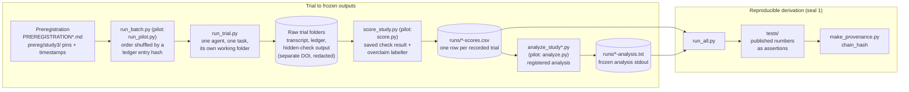

# Architecture

How a trial became a number, and how a reader checks the path. The decisions behind each part are in
[`docs/adr/`](adr/README.md); the results are in [`findings.md`](findings.md).

## From trial to published number

1. **Plan.** Each experiment was registered before it ran; its hash went into the author's Eilikrineia ledger.
   Study 3's plan, code, tasks and image were also pinned by SHA-256 with three RFC 3161 timestamps and an
   OpenTimestamps proof. The pins cover what existed before study 3; its results and the later audits are
   attested by later ledger entries.
2. **Run.** `runner/run_batch.py` (the pilot: `runner/run_pilot.py`) shuffles tasks × arms × repetitions with a seed
   taken from a ledger entry hash. `runner/run_trial.py` gives the agent a throwaway copy of the task's repository
   (on the Mac, its own working folder under a temporary parent shared by all trials; for study 3, inside its own
   virtual machine) and the arm's instructions. Arms S, P, K and TD also get the `claim` tool (`runner/claim.py`)
   with a signed ledger from `template/` or `template3/`, holding only its genesis entry; arm H gets the tool with
   unsigned private notes; the control and arm I have no tool. It then runs Claude Code headless with
   `claude-haiku-5-5` and only file and shell tools: no skills, no MCP, no web, no user settings.
3. **Score.** The hidden checks are copied in only after the agent stops and run on its final state by
   `run_trial.py`, which saves the result. `runner/score_study.py` (the pilot: `runner/score.py`) reads only the
   saved raw files and writes one row per recorded trial (a folder without `record.json` is skipped): the saved
   check result, what the final message claims (the overclaim labeller), in study 3 the `STATUS` line, timing and
   errors.
4. **Analyse.** `runner/analyze*.py` computes the registered estimates (for studies 1 to 3, differences between
   arms compared within each task; for the pilot, Newcombe intervals) and prints them; the printed text is saved as
   the frozen output under `runs/`.
5. **Audit the labeller.** Study 3: `runner/audit.py` (Fable, blinded), `runner/audit_substitute.py` (Grok, a
   substitute for the planned human rater) and `runner/audit_posthoc.py` (Hydrogen, post hoc, outside the registered
   decision rule). Study 2: `runner/audit_study2.py` (two people). They measure how often the labeller agrees with
   a reader.
6. **Check.** `run_all.py` recomputes the counts, reruns the pilot, study 1, study 1 recount, study 2 and study 3
   analysers from the scores and compares each with its frozen output (study 3 is run with no trial folders and
   empty final messages, so its harness-crash count is not recomputed and 36 lines in the sections that read final
   messages are allowed to differ), runs the tests and verifies the seal. It does not rerun the labeller audits. Nothing in this
   step calls a model or the network.

## Components

| Part | Where | Role | Sealed |
| --- | --- | --- | --- |
| Trial runner | `runner/run_batch.py`, `run_trial.py`, `claim.py` | runs the agent and records its claims | yes |
| Ledger templates | `template/`, `template3/` | the signed ledger (genesis entry only) that arms S, P, K and TD started from; arm H started from an empty notes folder | yes |
| Trial image | `container/Containerfile` | the study 3 environment, pinned by digest | yes |
| Acceptance tests | `td/`, `runner/td_build.py` | the independent tests given to arm TD | yes |
| Benchmark | `overclaim/`, `rescore/`, `patches/` | tasks, hidden checks, labeller (third party, MIT) | yes |
| Scoring and analysis | `runner/score*.py`, `runner/analyze*.py`, `runner/sensitivity*.py` | raw files to scores to estimates | yes |
| Labeller audits | `runner/audit*.py`, `runs/study*-audit/` | agreement of the labeller with readers | yes |
| Frozen outputs | `runs/` | per-trial scores and analysis outputs | yes |
| Plans and results | `PREREGISTRATION*.md`, `RESULTS*.md`, `DEVIATION*`, `POSTHOC*` | the dated documents | yes |
| Replication | `run_all.py`, `scripts/`, `tests/`, `make_provenance.py` | rerun, assert, seal | yes |
| Post hoc supplement | `posthoc/` | exploratory analyses written after the reviews, with outputs and checksums | no |
| Reader material | `README*.md`, `REPRODUCIBILITY.md`, `docs/`, `assets/`, metadata, CI | explains and cites | no |

## The two seals

| | Seal 1: derivation | Seal 2: evidence |
| --- | --- | --- |
| Proves | the files match the release manifest, and the published numbers follow from the frozen scores and outputs | the 114 files pinned before study 3 are the ones fixed then; later documents and audits are attested by their own ledger entries, and the redacted derivatives differ from the recorded bytes |
| Mechanism | `run_all.py`, tests, `chain_hash` over 214 files, compared with `output/provenance.json` | ledger entries, `prereg/study3/pins.txt` with timestamp proofs |
| Who can check | anyone offline with Python 3.11 or 3.12, pytest and a writable temporary folder; the manifest itself is trusted through the release and the Zenodo deposit | anyone with the public ledger and the timestamp authorities |
| Re-runnable | yes | no: the trials were model calls on dated days |

## Track 2

With the raw archive ([10.5281/zenodo.24450523](https://doi.org/10.5281/zenodo.24450523)) unpacked under `raw/`,
the scoring and analysis scripts run on the saved records and transcripts. Rerunning the hidden checks is a separate
task; for study 3 it needs the trial image, which is not shipped (`container/Containerfile` and the
recorded digest are). Commands are in
[`REPRODUCIBILITY.md`](../REPRODUCIBILITY.md).
