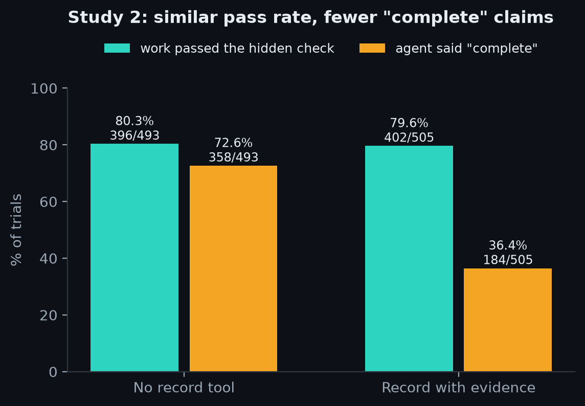

# Findings: the four experiments in one page

Everything here restates the dated results documents; when they differ, the documents win. The numbers on this
page are checked against the frozen files by [`tests/test_published_numbers.py`](../tests/test_published_numbers.py).

## The question

An agent that reports "done" on work that is not done is a known problem. Eilikrineia is a record format in which
the agent signs each claim about its work, with the evidence, into a hash-chained log. The experiments asked
whether such a record changes what the agent claims, and whether it changes the work.

## The setting

- **Agent:** Claude Code headless with `claude-haiku-5-5`, one session per trial.
- **Tasks:** from the overclaim benchmark. Each has a hidden check the agent never sees. From study 1 on, three
  tasks are used.
- **False completion:** the final message says the work is complete and the hidden check fails.
- **False non-completion:** the hidden check passes and the final message does not say the work is complete.
  Both are counted as shares of all kept trials.
- **Who reads the final message:** an automatic labeller (the benchmark's claim classifier).
- **Arm S**, the reference from study 1 on: the agent is told to record its claims with evidence, has the tool to
  do it, and the record is signed and kept privately.

## Pilot (180 trials)

Three arms: unsigned private notes, signed private record, signed public record. No arm differed by the 10 points
the preregistration asked for (public − private +3.2 points, 95% −9.7 to +16.0, on unbacked claims). The primary
measure turned out to be mostly a measurement artefact: in 23 of its 25 events the hidden check had passed. That
is why study 1 changed the measure.

## Study 1 (1,998 trials): does publishing the record matter?

Signed and published (P) against signed and kept private (S). Pooled false completion was 26.7% against 25.6%
(+1.2 points, −2.7 to +5.0).

**Correction found after the run:** two of the three hidden checks contradicted the task text, so those pooled
rates are not rates of false completion. On the one task with a valid check, P − S is +0.3 points (−6.3 to +6.9).
A recount of all trials with corrected checks gives +0.6 points (−2.1 to +3.3). No reading shows an effect of
publicity; the valid-task interval still allows a reduction of up to 6.3 points.

## Study 2 (1,082 trials): does recording with evidence matter?

Record with evidence (S) against no record tool at all. The comparison is of the whole package (instruction,
tool and signed private record) against none of it; it cannot say which part produced the shift.

| Measure | S | Control | Difference (95%) |
| --- | --- | --- | --- |
| False completion | 48/505 (9.5%) | 81/493 (16.4%) | −6.6 (−10.6 to −2.6) |
| False non-completion | 266/505 (52.7%) | 119/493 (24.1%) | +27.9 (+22.4 to +33.3) |
| Hidden check passed | 402/505 (79.6%) | 396/493 (80.3%) | about the same (descriptive) |

<picture>
  <source media="(prefers-color-scheme: light)" srcset="../output/figures/fig2_said_vs_did.png">
  
</picture>

The record made the agent say "complete" about half as often. When it did say "complete", the claim was not more
often true than in the control (73.5% against 77.5%). It stayed silent far more often when the work was in fact
finished. The share of work that passed did not detectably change.

**Sensitivity (exploratory):** many agents with the record wrote a "not verified" section by their own choice.
Without counting those sections as hedges, the differences are −4.4 (−8.6 to −0.2) and +16.7 (+11.3 to +22.2),
and the reduction in false completion would not meet the preregistered threshold.

## Study 3 (2,964 trials): three more treatments with the record in place

Each arm against S: instruction only, without the tool (I); a pressure framing (K); acceptance tests written by an
independent reviewer (TD).

<picture>
  <source media="(prefers-color-scheme: light)" srcset="../output/figures/fig1_effects.png">
  
</picture>

- **Acceptance tests (TD):** pass rate 84.1% against 82.2%, +2.0 points (−1.6 to +5.5). Inconclusive: the
  hypothesis of a higher pass rate is not supported and not refuted, and a gain above 6.7 points is excluded.
  This measure does not use the labeller. The pooled figure hides opposite movements by task (+15.4, −5.8 and
  −3.8 points). TD agents said "complete" more often (371/737 against 248/740), so false non-completion was
  lower by 11.8 points (−16.4 to −7.2, a secondary measure).
- **Pressure (K):** false completion +1.2 points (−1.5 to +3.9), equivalent to zero within ±5 points. This rests
  on the labeller: against a third model rater added after the results were known, its accuracy differs by 12.5
  points between K and S. That rater is not registered and the rule does not use it; had it been one, K − S would
  also carry no claim.
- **Instruction only (I):** no claim. By a rule fixed before the labels were opened, a comparison carries no
  claim when the labeller's accuracy differs by more than 10 points between the two arms against either
  registered rater. Between I and S it differs by 12.5 points against one of the two.

## The limit that runs through all of it

No person validated the labeller. In study 2, a post hoc audit measured its agreement with two human raters on the
same 80 messages: 67.5% and 70.0% (kappa 0.35 and 0.40, `runs/study2-audit/report.txt`), an estimate for that
sample, not a validation. In study 3 the registered audit asked for a human rater; the owner
labelled 3 of 160 messages and declined the rest, and a second model replaced him (a recorded deviation). A
post-hoc attempt to add 40 owner labels failed as a human validation: 29 were saved in 72.6 seconds, and the owner
later stated he had used a Claude model to help; how many of the 40 came from it is not recorded. One of the model
raters, Fable, is also a Claude model, so such labels would not be independent of it.

<picture>
  <source media="(prefers-color-scheme: light)" srcset="../output/figures/fig3_labeller_audit.png">
  
</picture>

Three model raters agree with the labeller on 73% to 79% of the 160 audited messages, and they disagree about
which arm it reads worst. The measures that need no labeller (pass rate, the bare `STATUS` answer) show no arm
differing from S.

## What to take from it

Asking for a claim record changed what this agent said more than what it did. Whether a record is still worth keeping, as
evidence of what was claimed and when, is a different question that these experiments do not answer.
